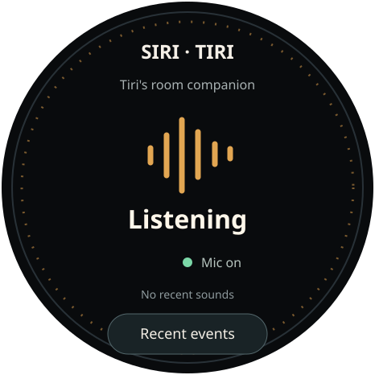
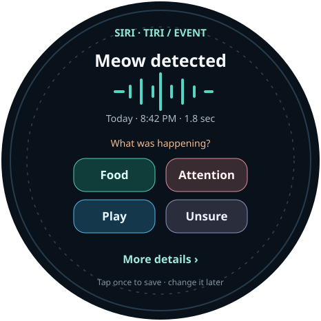
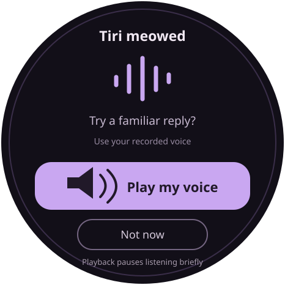
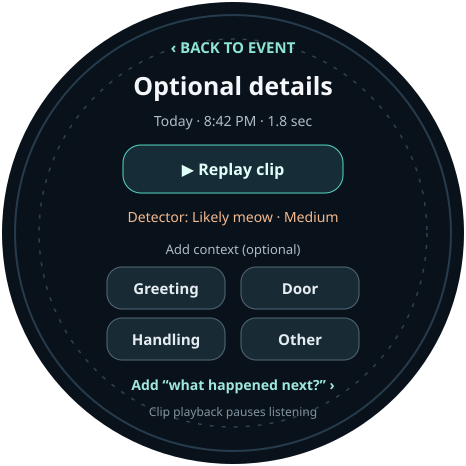
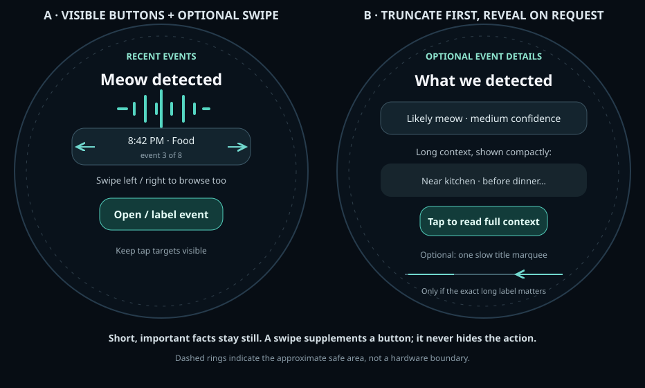
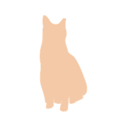
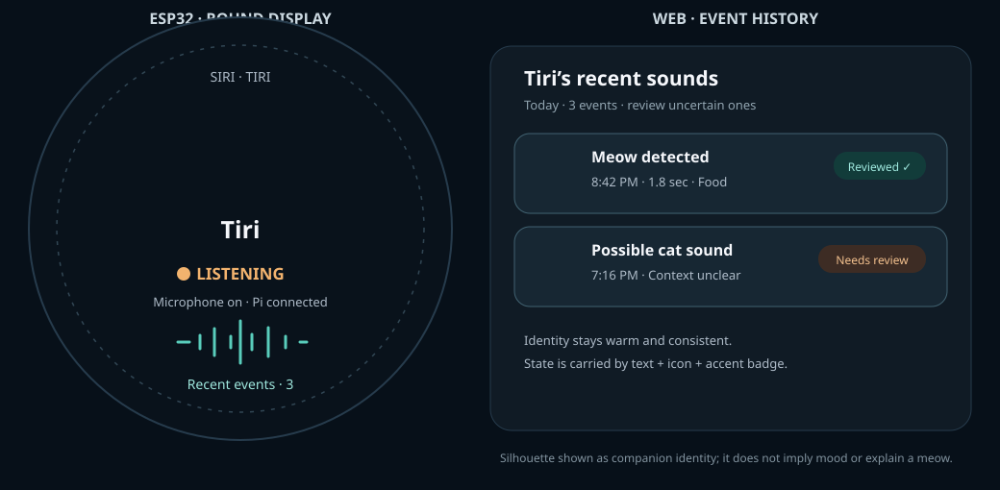

# Siri-Tiri Device UI Handoff

**Target:** Waveshare ESP32-S3 Touch AMOLED 1.75, ESP-IDF/Arduino + LVGL  
**Display:** round 466 × 466 px AMOLED, capacitive touch  
**User:** Andrey, with one cat at home: Tiri  
**Goal:** quickly see when a likely cat vocalization was detected, teach the system what was happening, and optionally respond in the owner's voice.

## Product direction

Use an **event-first companion**: the device spends most of its time in a quiet listening status, then makes reviewing and labeling a detected sound the main action. It should help Andrey build a personal history of Tiri's patterns, not present an unverified “translation.” Use phrases such as “Meow detected,” “Context unclear,” and “This often happens before dinner” only when backed by enough Tiri-specific examples.

The ESP32 is the room endpoint and touch UI. The Raspberry Pi/Home Assistant service performs the initial YAMNet inference and provides optional household context. Sonos is an optional playback destination; its microphones are not used as an audio input.

## Screen mockups

These are 466 × 466 vector mockups and can be opened directly in a browser or used as LVGL layout references.

### 1. Listening / home

Primary purpose: show that the device is powered, whether listening is enabled, and how to get to recent events.

- Center: clear listening state and waveform.
- Lower status: microphone on/off, with a distinct muted state.
- Primary touch target: **Recent events**.
- Do not show fake cat presence, emotional state, or a continuously changing “mood meter.”

### 2. Review and label event

Primary purpose: collect quick, low-friction labels from Andrey.

- Show a short waveform, event time, and duration.
- Use calibrated wording: “Meow detected” and “Context unclear.”
- One tap on a context label completes the annotation.
- Initial labels: **Food**, **Attention**, **Play**, **Door**, **Greeting**, **Brushing/handling**, **Other**, **Unsure**. Show four most useful choices on the first view; a **More** action can expose the remaining categories.
- Never require a label. Allow **Unsure** and later correction.
- Optional second step: what happened next? **Ate**, **Approached**, **Settled**, **Meowed again**, **No clear response**.
- Provide **Replay** only as a secondary control; use low playback volume and pause detection during playback.

### 3. Optional reply

Primary purpose: let the user choose whether to respond, without making the device speak on its own.

- Ask “Try a familiar reply?” and make **Play my voice** the primary action.
- Keep **Not now** equally easy to reach.
- Use a small, user-curated set of owner-recorded phrases; do not synthesize or play cat meows by default.
- After playback, show **Did Tiri respond?** with **Approached**, **Settled**, **No**, and **Unsure**.
- Playback is opt-in, volume-limited, and has a cooldown to avoid detecting the device's own audio.

## Core workflows

### A. Normal listening

1. Boot into Listening or Muted according to the persisted user setting; show a brief boot/status state.
2. Home screen displays listening state and recent event count/shortcut.
3. Capture a short rolling audio buffer in RAM. Keep it local and discard it unless a candidate event is detected and retention is enabled.
4. On candidate vocalization, send the clip to the Pi inference service.
5. If likely meow/cat sound, show the event review screen. If uncertain or below threshold, keep it out of the interruptive flow and optionally put it in a low-priority event list.
6. Return to the home screen after a timeout or after annotation.

### B. Label an event

1. Review sound type, time, duration, and confidence band (avoid false precision such as “97% hungry”).
2. Tap a context label or Unsure.
3. Optionally add outcome feedback.
4. Save event metadata and permitted clip locally/on the Pi.
5. Return to Listening with a small “Saved” confirmation.

### C. Play a response

1. User explicitly opens Reply or taps a suggestion.
2. Display the selected recording/phrase and sound level.
3. User taps Play my voice.
4. Pause listening/inference while playing; resume after a short cooldown.
5. Ask whether Tiri reacted only if the user remains on screen; never treat lack of tap as a negative result.

### D. Review history and settings

- Recent events: newest first, date/time, sound type, selected context, and whether a clip is retained.
- Settings: listening enabled, local clip retention duration, inference/Pi connection status, device speaker volume, Sonos target, approved owner recordings, and clear/delete controls.
- Make microphone state visible on every screen. The board has no dedicated physical mic-mute switch, so provide a prominent touch mute control and clear muted indication. Consider adding a real hardware mute control in a future enclosure revision if the microphone path can be safely gated.

## Navigation and controls

### Touch

- Touch-first interaction; no small menus or precision gestures.
- Use large targets (target 56 × 56 px or larger where practical). Keep important controls inside an approximately 390 px diameter safe area; avoid text and buttons near the round screen edge.
- Prefer tap, explicit Back, and vertical scrolling for history. Avoid relying on edge swipes, long-presses, or multi-touch for core tasks.
- Keep each screen to one primary action and at most two secondary actions.
- Provide a visible Back/Close control on review and settings. A timeout may return to Listening, but must not discard a label in progress.

### Physical buttons

The PWR and BOOT buttons are board-level controls, not assumed general-purpose app buttons.

- **PWR:** preserve the PMIC/power behavior defined by Waveshare's BSP; do not repurpose without verifying the hardware/firmware behavior.
- **BOOT/GPIO0:** could support a short runtime action (such as mute toggle) only after firmware and enclosure validation. Holding it during reset may enter download mode, so do not assign a hold gesture or rely on it as the sole mute control.
- All essential app actions must remain available through touch.

## UI states and feedback

- **Booting:** logo/title, then connected/offline state; do not block indefinitely waiting for the Pi.
- **Listening:** mic enabled, Pi status, recent event shortcut.
- **Muted:** obvious muted icon and text; no audio capture/transmission.
- **Processing:** brief, non-blocking indicator with cancel/timeout.
- **Event found:** event type and confidence band; no intent claim.
- **Offline:** show that sound detection may be unavailable; local mute and settings remain usable.
- **Saving:** confirm when feedback is persisted; show retry if service is unavailable.
- **Reply playback:** explicit speaker indicator, volume control, listening cooldown, stop control.
- **Low battery/charging:** show only when battery telemetry is valid; board PMIC supports battery status.

## Feature priority

### P0 — first usable build

- Listening/Muted home state and visible mic status.
- Candidate event notification and recent-event review.
- Fast labels including Unsure.
- Pi connection state and graceful offline behavior.
- Delete/retention controls for recorded clips.
- Local device speaker playback for reviewing a clip, with detection paused.

### P1 — after detection and labeling are reliable

- Event history and optional outcome feedback.
- Owner-recorded reply phrases.
- Sonos playback through Home Assistant.
- Simple settings for volume, retention, and reply behavior.
- Context from Home Assistant, shown as supporting evidence rather than a definitive interpretation.

### Later

- Tiri-specific pattern summaries after sufficient reviewed examples.
- Notification/suggestion personalization and quiet hours.
- Multiple cat profiles only if household changes.
- On-device inference only after comparing Pi service and ESP32 performance.

## Visual and interaction guidance

- Dark AMOLED base to take advantage of true black and reduce visual glare; use warm amber for listening, teal for saved/positive feedback, and muted violet for reply controls.
- Use high contrast, short labels, and a type scale roughly 14–28 px; body text should usually be 16 px or larger on the screen.
- Do not encode status by color alone; pair color with text/icon.
- Keep motion subtle: a slow listening pulse is fine; avoid constant animation that suggests sound is being captured when muted.
- Use short haptics only if the board has a supported tactile output added; it has no built-in vibration motor.
- Audible feedback should be off by default or quiet, to avoid disturbing Tiri.

## Developer notes

- Implement as a small set of LVGL screens/components with explicit state transitions: Home, EventReview, LabelMore, Reply, History, Settings.
- Keep audio inference and UI state separate. UI consumes event/state messages from the device/Pi service; it should not infer semantics from raw model scores.
- Surface detector output as “likely meow”/“possible cat sound” plus confidence band. Only the downstream personalized model may produce cautious context suggestions.
- Give event review a stable ID so a label can be retried safely if the Pi is temporarily offline.
- Define clip retention and deletion in the service contract; do not silently upload audio to a cloud endpoint.
- Preserve microphone state during navigation and restore it after playback cooldown.
- Verify actual touch controller orientation, circular edge dead zones, PWR/BOOT access, and screen safe-area against the final enclosure.

## Acceptance criteria

- From the home screen, a user can identify mic state and open recent events in one tap.
- A candidate event can be labeled in one tap, or explicitly marked Unsure.
- Muting stops recording/transmission and is visibly confirmed.
- Pi disconnection does not freeze the UI or prevent local mute/settings access.
- Playback cannot create an immediate self-detection loop.
- No screen claims to know Tiri's exact meaning or emotional state.
- Every retained clip can be reviewed and deleted.

## Hardware reference

- Board: [Waveshare ESP32-S3 Touch AMOLED 1.75 hardware reference](https://github.com/waveshareteam/ESP32-S3-Touch-AMOLED-1.75/blob/main/HARDWARE_REFERENCE.md)
- Project: [siri-tiri](https://github.com/a-tsygankov/siri-tiri)

## Round-screen event review refinement

The panel is a true 466 × 466 circle. Treat the outer edge as unavailable for essential text or controls. Use a centered safe circle about 390 px in diameter (roughly 38 px of inset from the panel edge), then verify real touch coordinates and any bezel/enclosure occlusion on the hardware. Keep the title, event facts, all primary actions, and navigation inside that safe circle. The older review mockup placed some lower button corners too near the rim; use the compact mockup below as the revised layout reference.

### Event review options

| Pattern | First screen | Optional details | Trade-off |
|---|---|---|---|
| **Quick label + More (recommended)** | “Meow detected,” brief timestamp, and four large context choices: Food, Attention, Play, Unsure. One tap saves. | “More” opens additional context labels, clip playback, model confidence band, and outcome feedback. | Fast for routine examples; details stay available without crowding every event. |
| **One question at a time** | Ask “What was happening?” and show one large choice with previous/next arrows; tap choice to save. | Browse all labels, replay, and add an outcome on a second page. | Largest tap target and clearest focus, but slower when labeling many events. |
| **Event card first** | Show “Meow detected,” time, and a large “Review” action. | The next screen contains labels, playback, and details. | Very calm and uncluttered, but adds a tap before the main task. |

Use **Quick label + More** as the default because the common task remains one tap while the optional fields are genuinely optional. If the four labels prove too dense at the device’s actual viewing distance, fall back to **One question at a time** rather than shrinking the controls.

### Compact review workflow

1. The event alert opens directly to the quick-label screen.
2. The screen shows the event type and time in the upper half, plus four context buttons in a centered 2 × 2 grid.
3. Tapping a context button saves immediately and returns to Listening. A small **More details** link opens the optional page.
4. The optional page can include:
   - Replay clip (explicit tap; pause listening during playback).
   - Approximate duration and time.
   - Detector label and confidence band, such as “Likely meow” / “Possible cat sound”; avoid false precision.
   - Additional context: Greeting, Door, Brushing/handling, Other.
   - “What happened next?”: Ate, Approached, Settled, Meowed again, No clear response, Unsure.
5. A visible Back/Close action returns to the quick-label page without losing any choice. A label is not required to dismiss the event.

Do not show waveform, exact model scores, confidence percentages, inferred intent, household context, and feedback controls all at once. Optional evidence should be disclosed on demand and described as evidence, not a translation.

### Round-layout and touch rules

- Keep important content inside a centered safe circle about 390 px across. Avoid placing button corners, status text, or back controls at the very bottom or far sides.
- Prefer a 2 × 2 button grid centered below the event facts. Target at least 48 px control height and leave visible gaps between hit areas.
- Use short labels and 1–2 text lines. Truncate secondary metadata instead of wrapping into the curved edge.
- Avoid radial menus that put small targets around the circumference. A circular screen does not make edge targets easier to reach.
- Avoid swipe-only navigation. A tap target for **More details**, plus visible Back, works for either hand and avoids accidental edge gestures.
- Use display masks or circular clipping only for artwork and background decoration; place actual text and hit targets inside the safe circle.
- Validate the layout on the 466 × 466 panel with the bezel and enclosure installed. The SVG is a layout guide, not a touch-calibration guarantee.

## UI framework options

| Option | What it provides | Fit for this device |
|---|---|---|
| **LVGL 9 with Waveshare’s board support package (recommended)** | Embedded widgets, layouts, touch input, and display refresh; Waveshare publishes examples for this exact 466 × 466 panel, including LVGL 9, touch, and an LVGL SquareLine demo. | Best match for this app and the exact hardware. Start from the board vendor’s LVGL example/BSP rather than mixing in another board’s display driver. Choose ESP-IDF or Arduino based on the existing firmware; keep the LVGL major version aligned with that example. |
| **SquareLine Studio (optional visual editor)** | Desktop UI editor that exports LVGL UI code; supports round-display project settings. | Use it to explore layout and generate static screen structure/assets, while keeping event logic, network state, and component behavior in hand-written firmware. It complements LVGL; it is not a replacement GUI runtime. Confirm its LVGL export version matches the firmware. |
| **Arduino_GFX / direct drawing** | Lower-level drawing primitives and text rendering. | Fine for a tiny fixed screen with a few hand-drawn controls, but it provides less reusable widget and interaction structure. The vendor supports it for basic display examples, while its richer touch UI examples use LVGL. |
| **ESP-Brookesia** | Espressif’s broader product/HMI framework, including app/runtime/service layers on top of GUI components. | Technically available in the vendor’s firmware examples, but likely more framework than this small, single-purpose companion needs. Borrow patterns or examples only if the project later grows into a multi-app device. |

**Recommendation:** Keep the product UI on LVGL using the Waveshare BSP and its compatible LVGL version. Use SquareLine Studio only if it speeds up screen composition. The strongest evidence is the board vendor’s exact-device LVGL examples and factory SquareLine/LVGL demo; the recommendation is an engineering judgment based on the app’s small screen count and interaction needs.

### Framework references

- [Waveshare board repository and example catalog](https://github.com/waveshareteam/ESP32-S3-Touch-AMOLED-1.75)
- [Waveshare examples: LVGL widgets, touch, SquareLine, and board-specific requirements](https://github.com/waveshareteam/ESP32-S3-Touch-AMOLED-1.75/blob/main/docs/examples.md)
- [Waveshare board support component](https://components.espressif.com/components/waveshare/esp32_s3_touch_amoled_1_75)
- [LVGL](https://github.com/lvgl/lvgl)
- [SquareLine Studio](https://squareline.io/)
- [Espressif ESP-Brookesia](https://github.com/espressif/esp-brookesia)

## Small-screen interaction: swipes and moving text

The Android Wear and Apple Watch guidance is useful as a reference for a round, glanceable surface, but this ESP32 has no watch bezel or crown. Keep input touch-first and borrow only the patterns that translate.

### Touch strokes / swipes

Use gestures as **shortcuts that duplicate visible actions**, not as the only way to act.

- Good candidate: on Recent Events, a horizontal swipe moves to the previous or next event; keep visible previous/next tap targets as well.
- Also reasonable: a standard swipe-back to close an optional detail page, provided a visible Back control remains.
- Keep event labeling, mute/unmute, playback, and any action that commits or deletes data as explicit taps. A swipe may be misread or performed accidentally.
- Avoid custom drawn shapes, multi-finger strokes, or gestures that depend on starting from an invisible region. The device is stationary, so these patterns add memorization without a clear benefit.
- Do not make vertical swipes compete with a vertically scrolling page. If a screen scrolls, use the swipe for scrolling and reserve other gesture directions for a distinct navigation purpose.
- Give each gesture a clear hint the first few times, or a small persistent affordance such as “Swipe to browse”; keep the visible controls usable even after the hint is dismissed.

### Running / marquee text

Moving text can help when the exact content matters and is too long to fit, but it should be an exception.

- For the usual event screen, keep short event facts stationary. Prefer a short label, a second line, or ellipsis with a tap-to-expand details action.
- Reserve marquee for a rare long title or device/room name that the user needs to identify in full. Show at most one moving line at a time, with a short delay before it starts and a pause at each end; do not animate every status field.
- If the exact full text is important for a decision or annotation, tapping to open a stationary details view is more reliable than requiring the user to catch a moving line.
- LVGL supports label overflow modes including scrolling/back-and-forth and circular scroll; that is a rendering capability, not a reason to make every long string move.
- Treat sustained automatic movement as an accessibility concern. WCAG 2.2.2 recommends a way to pause, stop, or hide automatically moving or scrolling content that persists over five seconds alongside other content. For this device, the simpler design is to avoid persistent marquee or provide a tap/pause affordance.

### Practical recommendation for Siri-Tiri

- Use horizontal swipe only for browsing between events, as a duplicate of visible event navigation controls.
- Use tap-to-reveal for long context and detector metadata. Do not auto-scroll the event alert or home screen.
- Consider a slow, single-line marquee only for future user-provided names (for example, a long room or speaker name) after testing it on the actual panel. Keep the label fixed while its text moves, and stop motion when the user touches or leaves the screen.
- The new comparison mockup demonstrates these choices; it is an interaction study, not a requirement to implement marquee.

### Sources and limits

- [Apple Human Interface Guidelines: Designing for watchOS](https://developer.apple.com/design/human-interface-guidelines/designing-for-watchos/) recommends glanceable, focused interactions; its hardware-specific crown guidance does not apply to this ESP32.
- [Apple Human Interface Guidelines: Gestures](https://developer.apple.com/design/human-interface-guidelines/gestures/) describes swipe as a familiar way to reveal actions, dismiss views, and scroll.
- [Android Wear: adaptive design for round displays](https://developer.android.com/design/ui/wear/guides/foundations/adaptive-design) describes distinct layout needs for round scrolling and non-scrolling screens.
- [Android Wear: media controls](https://developer.android.com/design/ui/wear/guides/patterns/media/controls) provides a useful precedent: long media titles can scroll while secondary artist text truncates, with minimum tap targets preserved.
- [LVGL 9 label overflow](https://lvgl.io/docs/open/9.4/details/widgets/label.html) documents the available label scrolling modes.
- [W3C WCAG 2.2.2: Pause, Stop, Hide](https://www.w3.org/WAI/WCAG22/Understanding/pause-stop-hide) explains the pause/stop/hide guideline for persistent moving content. Its formal applicability depends on the interface and context; here it is used as a general accessibility design reference.

## Cat silhouette system

The [feedme2 cat asset set](https://github.com/a-tsygankov/feedme2/tree/main/assets/cats) contains 12 transparent silhouette masters (A1–C4). Its existing renderer produces 256 px alpha-mask PNGs for the web and 130/88 px white-on-transparent PNGs for LVGL recoloring. That gives Siri-Tiri a shared, crisp cat identity across the ESP32 and web UI without adding a new illustration style.

The PNG above is a directly rendered, colorized preview of the A1 silhouette. The cross-device layout mockup follows it.

### Visual roles

| Surface | Use the silhouette for | Keep separate from the silhouette |
|---|---|---|
| ESP32 Listening home | A single medium Tiri avatar as the friendly anchor; show Tiri’s name below/near it. The mic state, network state, and event count remain compact labels around it. | Listening/muted state should use its own mic icon, text, and status accent. Do not make the cat itself look “happy,” “hungry,” or “worried” based on model output. |
| ESP32 event alert/review | A small avatar next to “Meow detected” or “Possible cat sound,” reinforcing that this is Tiri’s household log. Keep context buttons as the main tap targets. | The avatar must not compete with Food/Attention/Play/Unsure or imply that the pose is the event classification. |
| ESP32 saved/offline/playback states | Keep the same avatar; add a small check, disconnected link, or speaker badge and short state text where useful. | Avoid making pose changes the only indication of a state. |
| Web dashboard and event history | Use the same avatar in the Tiri profile/header and as a small marker in sound-event rows, filter chips, and empty states. This connects the device and web log visually. | Use explicit status chips (“Reviewed”, “Needs review”, “Clip retained”) and accessible text; color alone should not distinguish records. |
| Future multiple-cat support | Give each cat a stable avatar pose and personal accent, then use names as the primary identity. | Do not use arbitrary pose/color changes to encode sound meaning; identity should remain stable across sessions. |

### State color and pose rules

- Treat the silhouette as **Tiri’s identity illustration**. Choose one default pose and keep it stable; let Andrey choose another pose later as a profile personalization option.
- Use the same Tiri accent on the device and web app. The initial mockup uses a warm peach silhouette on dark AMOLED; the pose remains fixed.
- Show operational state with a redundant badge: **Listening** + microphone icon + amber accent; **Muted** + crossed-mic icon + slate accent; **Saved** + check + teal; **Offline** + connection icon + text. The silhouette may dim slightly when muted, but its color must not be the only status cue.
- Processing can use a subtle ring or short waveform animation around the avatar, but stop when muted and avoid an endless “listening pulse” that could imply capture is active when it is not.
- Do not map the 12 pose filenames to emotions or needs. The asset README names them A1–C4 but provides no state/intent semantics, and pose meaning is subjective.

### Implementation reuse

- Inspect the [asset README](https://github.com/a-tsygankov/feedme2/blob/main/assets/cats/README.md) and [renderer](https://github.com/a-tsygankov/feedme2/blob/main/assets/cats/render.py). It already crops alpha, adds transparent padding, and creates web/firmware outputs.
- For the Siri-Tiri repo, pin the source revision and either copy the selected source PNG(s) plus a small deterministic renderer or create a documented shared asset package. Avoid fetching silhouettes at runtime from GitHub; embedded/device UI and web history should work offline.
- On the ESP32, use a small 88 px avatar on event/status rows and a 130 px avatar only on the home/identity screen. The feedme2 renderer’s 130/88 sizes show a tested pattern; verify memory/render cost with this board’s LVGL version before copying its generated C data.
- On the web, use the generated alpha PNG as a CSS mask and apply the Tiri accent through CSS. Provide an accessible label such as “Tiri” when the image identifies the cat; hide it from assistive technology when the adjacent text already gives the same name.
- Before copying or redistributing files across repositories, confirm the source images’ license/attribution terms; no separate license was found in the asset folder.

### Priority

- **P0:** Tiri avatar on Listening home and web event list; stable color; text/icon status badges.
- **P1:** avatar on event review, saved confirmation, and empty history; test 88 px/130 px firmware variants.
- **Later:** profile pose selection, additional cat profiles, and optional gentle animation after the core status colors and labels are readable.

### References

- [feedme2 cat asset folder](https://github.com/a-tsygankov/feedme2/tree/main/assets/cats)
- [WCAG 2.2: Use of Color](https://www.w3.org/TR/WCAG22/#use-of-color)
- [WCAG technique: convey color information in text](https://www.w3.org/WAI/WCAG22/Techniques/general/G14)

## Research-informed use of the cat silhouettes

The silhouette set is most useful as a **persistent visual identity for Tiri**, with a secondary role in making event history feel personal and easy to scan. It should not carry the meaning of a detected sound or claim to show Tiri’s current mood.

### Recommended patterns

| UI surface | Recommended use | Interaction and content |
|---|---|---|
| ESP32 home | Keep one medium silhouette and “Tiri” as a calm identity anchor. The existing round-screen mockup demonstrates this. | Keep Listening/Muted, microphone, and Pi connection in separate labeled status text and icon. The cat remains visually stable as state changes. |
| Event review | Use a small silhouette beside “Meow detected” or “Possible cat sound” to identify whose event is being reviewed. | Keep the event type, time, context choices, and **More details** as the primary information/actions. The avatar is not a label and does not suggest Food, Attention, or Play. |
| Web event history | Repeat the same small silhouette beside Tiri’s name and event rows. This supports quick scanning and gives the device and web history a shared identity. | Use explicit **Reviewed** / **Needs review** text badges; a check or clock icon and color may reinforce, but never replace, the words. |
| Profile and settings | Offer optional manual pose/color personalization in a profile screen, after the default experience works. | Label this as appearance or avatar choice. Keep a stable selection across screens and sessions; do not rotate poses automatically to express inferred states. |
| Empty and saved states | Use the silhouette sparingly to make “No events yet” or “Saved for Tiri” feel warm and specific. | Pair it with plain text and a next action when needed. Do not animate the cat to imply that it heard or understood something. |

### Color, pose, and state

- Keep Tiri’s silhouette tint stable by default. Prefer a separate microphone, connection, playback, or review badge next to the image when an operational state needs a quick visual cue.
- If status colors are used, pair them with a distinct icon and readable label. W3C guidance says color must not be the only way information is conveyed. This applies to the web UI and is a useful design rule for the device too.
- Avoid putting a badge over the cat’s face or body; use a small adjacent badge so the silhouette remains recognizable at compact sizes.
- Do not assign meanings such as “happy,” “hungry,” “anxious,” “wants attention,” or “meow understood” to A1–C4. The source asset README identifies these only as pose filenames, not a validated behavior vocabulary.
- Treat any pose that looks expressive as decoration/identity. Research on feline behavior assessment cautions that similar behaviors can arise from different emotional motivations; using a static silhouette to assert a specific feeling would add even more uncertainty.

### Tap, labels, and accessibility

- If tapping the avatar opens Tiri’s profile, make the whole hit area a real, visible control and label its action (for example, **Tiri’s profile**). Do not rely on users guessing that the picture is interactive.
- On the web, if the image is the profile link, its accessible name should describe the destination/action. If the adjacent “Tiri” text already supplies the same identity and the image adds no information, use a decorative/empty alternative so the name is not announced twice.
- Keep visible words beside icon-only states, especially **Listening**, **Muted**, **Offline**, **Saved**, and **Needs review**. W3C image guidance distinguishes informative, functional, and decorative images; choose the alternative based on what the image does in that specific UI.

### Validation before expanding the pose system

The current ui-cat-avatar-system.svg already shows the most valuable cross-surface pattern: one consistent Tiri avatar on the device and in event history, with event/state meanings carried by text and separate badges. Keep that as the design baseline.

Before using all twelve poses or adding state colors, show a few variants to household users at actual display sizes. Ask what each silhouette means, whether it looks like a mood or event label, and whether users can still find Listening/Muted and Needs review without relying on color. Check both the 466 px round screen and small event-row sizes. This is a lightweight way to catch accidental meanings and low-visibility details; it is not evidence that the system can infer cat emotion.

### Research basis and limits

- Nielsen Norman Group’s icon research recommends a text label to resolve ambiguity and describes testing icon interpretations in context. Applied here: keep “Tiri” and event/status wording beside the silhouette, and test poses before assigning semantics.
- W3C WAI explains that functional images need alternatives describing their function, informative images need an equivalent conveying their content, and decorative images should not add redundant announcements. It also says color should not be the only visual cue.
- A veterinary behavior review describes why behavior and body language can be difficult to map to a single feline emotion. That supports the conservative product choice to use these static assets for identity, not emotional interpretation. It does not directly study this particular silhouette set.
- The Feedme2 asset README names twelve poses A1–C4 and documents its alpha-mask/web and recolorable LVGL outputs; it does not define pose meanings.

Sources:

- [NN/g: Icon Usability](https://www.nngroup.com/articles/icon-usability/)
- [NN/g: Icon Usability Testing](https://www.nngroup.com/articles/how-to-test-digital-icons/)
- [W3C WAI: Images Tutorial](https://www.w3.org/WAI/tutorials/images/)
- [W3C WAI: Functional Images](https://www.w3.org/WAI/tutorials/images/functional/)
- [W3C WCAG: Use of Color](https://www.w3.org/WAI/WCAG22/Understanding/use-of-color)
- [Recognising and assessing feline emotions during the consultation](https://pmc.ncbi.nlm.nih.gov/articles/PMC11395287/)
- [Feedme2 cat silhouette README](https://github.com/a-tsygankov/feedme2/blob/main/assets/cats/README.md)
